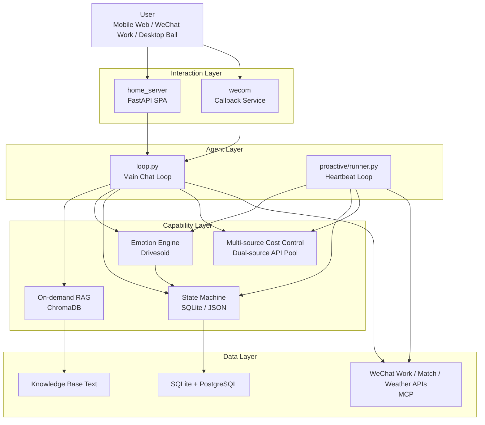

# Kairos — An AI companion that knows when to stay silent

**English** | [中文](README.zh.md)

   

**Kairos** is an AI companion agent that runs on a heartbeat loop — instead of replying to every prompt, it periodically decides whether to speak, write a diary entry, or stay silent. The system pairs a 16-dimension continuous emotion engine (independent Node.js process) with a multi-source API pool that routes each request based on peak/off-peak pricing and remaining quota. Built solo in 12 days: 7,283 lines of Python + 2,163 lines of JavaScript, delivered across web / WeChat Work / desktop with shared state. Open-source cleanup (redaction, test coverage, engineering hardening) added 3 more days.

**Tech Stack**: Python · FastAPI · LangChain · ChromaDB · Node.js (Express 4 + MCP SDK) · Vanilla JavaScript · WeChat Work API

> This project is a redacted release of a real AI companion system. Persona, memory, and narrative are configured by the user; the code layer contains no private information. First launch walks you through setting up your own persona and API keys.

---

## Project Scale

- **Python: 7,283 lines / 42 files**, **JavaScript: 2,163 lines / 9 files** (excluding dependencies and generated artifacts)
- **40 core backend modules** (32 in `backend/` + 8 in `wecom/`), **43 FastAPI routes** (counting `home_server.py` alone; 49 if wecom callback service is included)
- **7 RAG knowledge domains**, **3 MCP tools** (exposed by the emotion engine)
- Three front-ends (mobile web / WeChat Work / desktop), emotion engine as an independent process (REST + MCP dual protocol)
- Development period: original project Sep 13 – Sep 24, 2026, solo; open-source cleanup (redaction / tests / engineering hardening) added 3 more days.

---

## Four Technical Highlights

### 1. Proactive Agent: From "Responding" to "Initiating"

Most LLM applications are request-response. Kairos adds a **heartbeat loop** (`proactive/runner.py`) that periodically evaluates whether it's an appropriate moment to speak first:

- Assembles scenario context (training gaps / match day / travel / bedtime)
- Calls the LLM to generate a candidate "thought", then decides whether to push it to WeChat Work, write a diary entry, post a moment, or do nothing
- Interacts with a **character state machine**: `home_state.json` tracks the day's state (at home / out / match day), rolls over automatically when stale, and can be overwritten by signals from the conversation
- The heartbeat loop also drives several proactive behaviors: **match review** (while the companion is "working from home", it checks every 30 minutes for a just-finished match and auto-initiates a review pushed to WeChat Work), **daily diary** (auto-writes the first entry after 22:00, with the thought engine allowed to append more), and **match result notification** (pushes unread results proactively)

**The hard engineering problem is restraint** — too much proactivity becomes harassment. The system implements availability gating: sleeping / match / meeting scenarios are blocked outright, short replies are allowed during training gaps, and consecutive non-responses trigger a reassurance fallback rather than more pushes.

**Measured data** (from local run logs during development; data files are not included in the repo): out of 66 thought evaluations, only 23 crossed the send threshold (`speak_threshold`). **43 ended in deliberate silence — a 65% silence rate.** What the system actually does is "decide not to disturb", not "find a chance to talk".

### 2. Multi-Source Cost Control: Keeping Costs Down Under Proactive Request Volume

Proactive triggering multiplies request volume compared to passive mode. The system does not switch models; instead, it **schedules across multiple channels of the same DeepSeek model to lower per-call cost** (`backend/config.py`):

- **Dual-source API pool**: DeepSeek official API + Volcengine Ark API (both running DeepSeek models); the Ark side has two accounts: a free pool (api2) and a peak-hour pool (api3)
- **Automatic fallback by usage**: local cumulative token accounting (`api_usage.py`); when the primary pool's quota is exhausted, requests degrade to the backup pool
- **RAG on demand**: knowledge snippets are only injected when keyword triggers fire; everyday chit-chat retrieves nothing
- **30-minute weather cache** + **reasoning-chain length cap**: reduce unnecessary token consumption
- **Usage visualization**: balance and real-time usage of all three API routes are viewable in the web UI (`/api/home/api_usage`), so users can verify the routing strategy's effects themselves

**Measured data** (`backend/logs/usage.log`, 2026-09-18 → 09-27, 704 calls over 9 days): **91.8% of calls used Ark's free quota; 93.6% of tokens were consumed during off-peak hours.** Note: this distribution is also shaped by usage timing (peak-hour traffic was mostly development debugging, while chat requests were concentrated off-peak), so it is not purely an effect of the routing strategy. But the dual-source pool did absorb the extra request volume from proactive triggering without additional API spend.

### 3. Continuous Emotion Engine (Independent Node.js Service)

Rather than having the LLM "act out" emotions, the system makes emotion a **queryable state living in its own process** (`backend/drivesoid/`, port 24601):

- Maintains **16 continuous dimensions** (longing / intimacy / vitality / jealousy / anxiety / contentment / elation / possessiveness, etc.), each with its own time constant, peak time, and amplitude parameters
- The main chat loop periodically fetches the emotional context into the system prompt; emotional changes during chat are written back
- Dual entry points: REST API + MCP service — callable from Python, consumable by any MCP client

**Architectural significance**: turns "emotion" from a one-shot text snippet inside a prompt into a persistable, observable, testable state machine. A companion Python heartbeat engine (`companion_awakening/`) handles thought generation.

**Measured data**: **6,541 accumulated state snapshots**, each holding the full 16-dimension values, available for replay, visualization, and parameter tuning. The two emotion states (Node engine's 16 dimensions / Python thought engine's 8 fields) stay in sync via a mapping layer.

### 4. Mobile Engineering and Cross-Platform Consistency

`home_server.py` (FastAPI) provides the mobile web UI, including chat, calls, moments, diary, calendar, fridge, and other modules, plus match review (independent `/watch` route; requires configuring an MCP data source and API key) and date plans (`date_plans_manager`, downgraded to unavailable in the open-source release). The real pain is **iOS Safari**:

- `position:fixed` + `100vh` to avoid viewport jitter and soft-keyboard displacement caused by address-bar resizing
- `-webkit-backdrop-filter` dual-write for frosted-glass compatibility
- `-webkit-overflow-scrolling:touch` + `overscroll-behavior:contain` to prevent scroll chaining
- `Intl.DateTimeFormat` to bypass Safari's `toLocaleString` inconsistencies
- Front-end and back-end share `APP_TIMEZONE`; supports any IANA timezone, defaults to UTC

The interaction layer exposes three front-end capabilities:

- **One-click deep-thinking mode toggle**: user controls whether DeepSeek's reasoning_content output is enabled
- **Reasoning-chain viewer**: tap a chat bubble to expand reasoning_content and inspect the model's reasoning process
- **One-click chat-data wipe**: a button in the top-right of the chat window clears the backend `chat_history.db`; the front-end display persists until refresh

All three front-ends share the same SQLite chat history and state files; replies and state stay consistent in real time.

**Measured scale**: the mobile web chat history accumulated 463 messages, 70 of which carry reasoning chains; WeChat Work dedup tracks 248 message IDs. All three ends stay consistent with no cross-end discrepancies.

---

## Architecture



- **Data Layer**: SQLite + PostgreSQL (Supabase) — hot data stays local (chat history, state JSON, zero-ops for a single machine), while the cloud handles knowledge base and backups.
- **AI Layer**: on-demand RAG (only injected when keyword triggers fire) / emotion engine (independent process with multi-dimensional state) / agent-initiated triggering (heartbeat loop) / multi-source cost control (dual-source API pool + quota fallback).
- **Integration Layer**: MCP protocol (stdio JSON-RPC) / WeChat Work push / tunnel.
- **Interaction Layer**: mobile web (FastAPI SPA) / multi-page / desktop ball (Electron).

---

## System Capabilities

| Capability | Description |
| --- | --- |
| 🧠 Layered memory | Short-term (SQLite session) + core memory (manually maintained txt) + RAG vector store (7 domain scaffolds, content to be supplied by the user) |
| 💓 Continuous emotional state | Independent Node.js emotion engine, multi-dimensional emotion vector, chat ↔ state closed loop |
| ⏰ Proactive triggering | Heartbeat loop + scenario context assembly; the agent decides whether to push, record, or stay silent |
| 🔀 Multi-source cost control | Dual-source API pool (DeepSeek official + Volcengine Ark, same model); quota exhaustion triggers automatic fallback |
| 📱 Cross-platform consistency | Mobile web / WeChat Work / desktop ball share the same state layer |
| 🔌 External integrations | MCP protocol for match data, Open-Meteo weather, WeChat Work push |
| 🎛️ Interaction controls | One-click deep-thinking toggle; tap chat bubble to view reasoning chain; one-click wipe of backend chat data (front-end display persists) |

## Memory Design

Rather than relying on an ever-growing context window, the system implements long-term memory in layers:

- **Short-term context**: `chat.history` (SQLite) keeps the most recent N turns as the LLM's conversation window. Each user message is prefixed with a relative time tag (`_msg_time_tag`) at injection time — `(today 12:37)`, `(yesterday 23:40)` — so the LLM can distinguish "what was just said" from "what was said yesterday", with automatic timezone conversion.
- **Conversation summarization archive** (full version): conversations that fall outside the window are summarized into key information by `chat.history` internally, mimicking how humans compress distant events into memory. This logic lives inside the redacted `chat.history` module; the open-source release does not include it — users can implement their own conversation summarization.
- **Core memory**: `~/.kairos/memory_core.txt` (plain text), re-read and injected into the system prompt before every reply. Holds long-term facts like "key events / mutual likes / life details / future plans". **Maintained manually by the user.**
- **RAG vector store**: ChromaDB + `BAAI/bge-small-zh-v1.5` Chinese embeddings, 7 knowledge domains (football / geography / hobbies / intimacy / nutrition / psychology / trivia). Each domain maps to a `~/.kairos/<name>_kb.txt` source file; indexing is lazy-built on first retrieval and rebuilt automatically when the file changes.
- **Last-message timestamp**: `get_last_user_msg_time_text()` separately computes "how long ago the user's previous message was" (`just now` / `25 minutes ago` / `yesterday 21:30`), injected as an independent system block to give the LLM a global sense of time.

Beyond these layers, thoughts, diary entries, and moments are persisted independently by their respective modules and do not participate in memory retrieval.

---

## Limitations and Reflections

Built solo in 12 days, with deliberate trade-offs. The following issues are unresolved, or were implemented "just enough to run" rather than "reliably":

- **The proactive-triggering false-positive rate has not been systematically evaluated.** The current sense of restraint is inferred from 66 thought evaluations, 23 of which resulted in speech and 43 in silence — but we lack labeled data to distinguish "spoke when it should have" from "spoke when it shouldn't have". Availability gating relies on hardcoded rules (sleeping / match / meeting); scenarios outside those rules may be wrongly blocked or wrongly allowed.
- **Emotion engine initial values depend on existing chat history.** The 16-dimension starting point is hand-tuned from historical conversations, so a new user with no chat history has no personalized baseline at cold start.
- **API pool switching is invisible to the user, but latency has a cost.** Primary/backup pool switching happens on the request side, transparently to the user — but response latency differences between the two API endpoints have not been quantitatively compared.
- **Cross-platform consistency is only verified in online scenarios.** The three front-ends share a SQLite state layer that requires simultaneous access to the same storage; conflict resolution for simultaneous writes from multiple ends under offline or poor-network conditions is not handled.
- **Evaluation data comes from a single user over 12 days.** The 66 thoughts, 704 calls, and 6,541 snapshots are all self-measured during development — the sample is too small to support general claims. It shows "the mechanism runs", not "the mechanism works well".
- **The open-source release cannot run end-to-end.** `home_server.py` starts cleanly on its own (`diary_manager`, `moments_manager`, `watch_manager`, etc. are all in the repo), but `loop.py` at the top level depends on `chat.history`, `availability`, and `agent.arousal` — three modules not published with the repo. Triggering the main chat path fails with an import error. Readers can only verify the emotion engine and the WeChat Work integration as independent components; the chat main path requires filling in the three modules above.

- **Voice transcription and image recognition run through local sidecars that are not published.** `wecom/server.py`'s `_transcribe_audio` / `_analyze_image` only make HTTP calls (`127.0.0.1:24603` / `24602`); the actual model loading and inference happen in separate `sidecar/VoiceASR` / `sidecar/VisionBridge` processes, which are not part of the open-source repo. The text-message WeChat Work callback path runs fully; voice/image messages require you to implement or replace the sidecars.
- **API keys are stored in plaintext**: the current configuration (`~/.kairos/config.json`) is a simplified implementation; production use should switch to environment variables or a secrets manager.
- **Redaction is an iterative convergence process.** This project was redacted from a real running AI companion system. After the first pass removed major personal information, subsequent full-repo reviews surfaced additional leaks: pinyin variable names (`ringing_from_rin`), leftover real names (moments display name, player mapping table), placeholder dead paths (`YOUR_PATH`), cross-platform backslash paths, hardcoded tokens, and so on. Redaction is not a one-shot operation — it requires multiple rounds of scanning plus regression checks. All known leaks are logged in `SECURITY_REDACTION_REPORT.md`'s "Iterative Redaction Log" section; `grep` confirms 0 remaining.
- **Weather location is manually configured, not auto-detected.** The current setup uses `KAIROS_HOME_LAT` / `KAIROS_HOME_LON` environment variables for a fixed coordinate; if unset, weather injection is silently skipped. A natural extension would be to infer the current city from itinerary (schedule / calendar / location clues in user messages) — the open-source release intentionally keeps manual configuration as the minimal implementation, and users can swap in smarter location logic themselves.
- **Character state rules are defined by the user.** The structure of `home_state.json` and the state-reading logic are preserved in the open-source release, but the original rule module that auto-switches state based on schedule / time (`status_rule.py`) was removed during redaction. Users maintain their own state text — either by editing `home_state.json` directly or by implementing their own state-rule module.
- **Two usage-logging mechanisms coexist.** `api_usage.record_usage` (writes `~/.kairos/api_usage.json`, used for cost-control decisions) and `loop._log_usage` (writes `backend/logs/usage.log`, used for post-hoc analysis) partially overlap, a leftover from iterative development. Before merging them, the consumers of each dataset need to be identified.
- **Windows launcher scripts hardcode the Python 3.11 path.** Three `.bat` files use `%LOCALAPPDATA%\Programs\Python\Python311\python.exe`; users on 3.12 or a non-default install location will hit failures. Switching to the `py -3` launcher is more portable, but needs careful verification without a Windows CI environment.
- **Knowledge-domain keywords are role-specific examples, not a general vocabulary.** Constants such as `FOOTBALL_KEYWORDS` / `NUTRITION_KEYWORDS` / `HOBBIES_KEYWORDS` in `loop.py` reflect the original companion's persona (professional athlete, specific hobbies) and are quite fine-grained. Their purpose is to decide "which RAG knowledge base to trigger when the user mentions a given topic" — users should redefine these vocabularies around their own character. The txt content for each domain also needs to be supplied by the user (see the "Memory Design" section).

---

## Getting Started

### 1. Emotion Engine (Drivesoid, standalone)

Requires Node.js ≥ 18.

```bash
cd backend/drivesoid
cp .env.example .env   # fill in configuration as needed
npm install
npm start              # REST service, default port :24601
# or
npm run mcp            # start as an MCP Server
```

### 2. WeChat Work Integration (standalone)

```bash
cd wecom
pip install -r ../backend/requirements.txt
# write credentials to ~/.kairos/wecom_config.json
#   corp_id / agent_id / secret / token / encoding_aes_key
python run.py          # listens on 0.0.0.0:8765
```

### 3. Mobile Web + Proactive Triggering (requires filling in missing modules)

```bash
cd backend
pip install -r requirements.txt
# LLM three-source API config goes in ~/.kairos/config.json (api_key / base_url / model)
export APP_TIMEZONE=Asia/Shanghai   # optional, defaults to UTC

export KAIROS_HOME_LAT=39.9042      # optional, weather latitude (example: Beijing)
export KAIROS_HOME_LON=116.4074     # optional, weather longitude; if either is unset, weather injection is skipped

# optional: match-review feature (skipped silently if all three are unset; can also go in backend/home/.env)
export FIVEDOLLARFOOTBALL_API_KEY=<your-key>       # 5DollarFootballAPI key
export FIVEDOLLAR_LEAGUE_ID=<your-league-id>       # league ID to follow (e.g. Ligue 1)
export FIVEDOLLAR_HOME_TEAM_ID=<your-team-id>      # home team ID

# HOME_TOKEN is required, or the backend will fail at startup
# Windows (cmd):        set HOME_TOKEN=<your-random-secret>
# Windows (PowerShell): $env:HOME_TOKEN="<your-random-secret>"
# macOS/Linux:          export HOME_TOKEN=<your-random-secret>

python run.py   # mobile web (port 5971; first open shows a setup dialog)
# if the port is taken, set PORT, e.g. set PORT=5972
python proactive/runner.py   # proactive heartbeat
```

Open [http://localhost:5971/home?t=your-secret-token](http://localhost:5971/home?t=your-secret-token) in a browser → first open shows a setup dialog; fill in a name + API key + persona and you're good to go.

Note: `home_server.py` starts cleanly on its own; features like match review and date plans degrade gracefully when dependencies are missing (unavailable, but the service keeps running). However, the chat main path in `loop.py` depends on `chat.history`, `availability`, and `agent.arousal` — three modules not published with the repo — so triggering a chat will fail. To run end-to-end, supply those three modules yourself.

You can edit `backend/data/market_kb.txt` to customize the market catalog (format: `=== Category ===` followed by `- item name`); fridge restocking and "what was bought" matching use this as their data source.

---

## Tests

```bash
cd backend
pip install pytest httpx
python -m pytest tests/ -v
```

69 tests (CI runs Python 3.11), covering:
- `wecom/crypto.py`: AES-256-CBC round-trip (Chinese / long messages), signature ordering, tamper detection
- `agent/loop.py`: DST boundaries, schedule parsing, date-intent detection (4 pure functions)
- `config.py`: peak/off-peak timezone conversion + half-open intervals, config read/write round-trip, corrupted-JSON behavior
- `config.py`'s `effective_config`: three-source API routing (peak / web-api2 / quota-exhausted fallback / default), 11 branch boundaries
- `_suppress_intimate_state`: state-isolation context manager (including exception-path regression test)
- `home_server`: authentication + first-time setup flow

Tests inject stubs via `conftest.py` (openai / rag.* / private modules) so the public repo can run the full suite even without chromadb or sentence-transformers installed. Tests use a temporary HOME directory for isolation and won't touch your `~/.kairos/` configuration.

---

## Third-Party Components and Licensing

- Original code in this repository is released under the **MIT** license (see the root `LICENSE`, Copyright (c) 2026 Kairos Project).
- `backend/drivesoid/` is an **independent open-source component** (the emotion engine), released under its own **CC-BY-NC-SA-4.0** license (see `backend/drivesoid/LICENSE`).
- For commercial use, replace the emotion engine with your own implementation — the architecture is decoupled (REST + MCP dual entry points), so swapping it out does not affect the main path.
